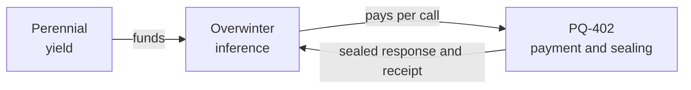

# post-quantum-apps

Post-quantum apps that keep running after Q-Day.

Three independent projects on [QoreChain](https://qorechain.io). Each one
stands alone; together they form a loop in which an agent's income, payments
and model calls are all post-quantum secured.



| Project | What it is | Repository | Status |
|---|---|---|---|
| Perennial | Pension protocol: the principal is never spent, only the yield is paid out | [raldblox/perennial](https://github.com/raldblox/perennial) | In development |
| PQ-402 | x402 extension: ML-DSA-87 signed payments, ML-KEM-1024 sealed requests | [raldblox/pq-402](https://github.com/raldblox/pq-402) | Planned |
| Overwinter | OpenAI-compatible inference adapter that pays through PQ-402 | [raldblox/overwinter](https://github.com/raldblox/overwinter) | Planned |

Projects are added here as submodules when they reach a tagged release.

```bash
git clone --recurse-submodules https://github.com/raldblox/post-quantum-apps
```

## License

[MIT](LICENSE)
